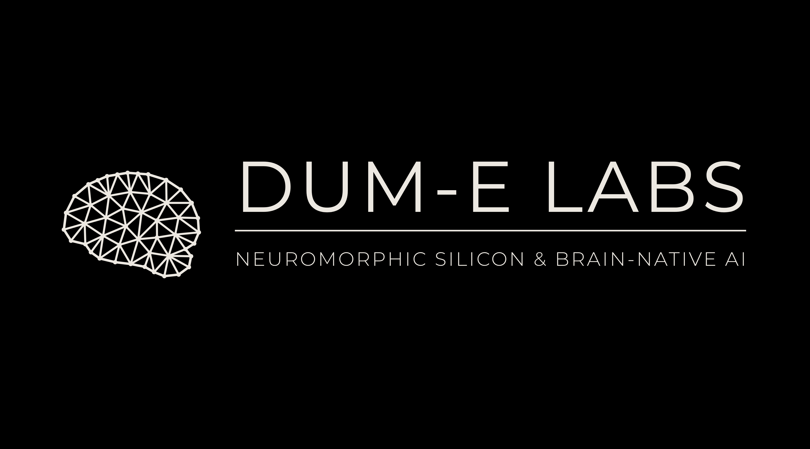

<div align="center">

<a href="https://dummie-labs.github.io/.github/"></a>

# DUM-E Labs · website & brand

**Memory that thinks.** Neuromorphic silicon (**MNEMOS**) and brain-native AI (**SOMA**).

[**Live site**](https://dummie-labs.github.io/.github/) · [Org profile](https://github.com/Dummie-Labs) · [Founder on LinkedIn](https://www.linkedin.com/in/rishikeshvarma-kucharlapati/)

</div>

---

This repository is the DUM-E Labs organization's `.github` repo. It holds three things:

1. **The organization profile**: [`profile/README.md`](profile/README.md), shown on [github.com/Dummie-Labs](https://github.com/Dummie-Labs).
2. **The company website**, served by GitHub Pages from `main` at **https://dummie-labs.github.io/.github/**.
3. **The brand kit**: logos, mark, banner and favicon in [`brand/`](brand/).

## Website

| Section | What it shows |
| :--- | :--- |
| Hero | 3D neural brain (~4k neurons, live spike pulses), "Memory that thinks." |
| 01 · The wall | Von Neumann bottleneck vs compute-in-memory, with cited energy figures |
| 02 · The blueprint | Interactive brain map (lobes, tracts, region → chip mapping), neuron anatomy + live LIF membrane trace |
| 03 · MNEMOS-1 | Scroll-driven 3D chip walkthrough (8 steps), interactive memristive crossbar, target spec, comparison table |
| 04 · SOMA | Live spiking network with STDP, dopamine-gated learning, synapse growth & pruning |
| 05 · Roadmap | Phase 0 → brain-scale intelligence |
| 06 · The lab | Founder, open roles, links |

The page loops: scroll past the footer and it continues seamlessly into the hero.

```
index.html              the site
readme.html             "Lab notes": renders profile/README.md in the site's style
assets/css/site.css     styles (black + bone palette from the logo)
assets/js/
  main.js               nav, reveal, marquees, infinite loop scroll, animated marks
  brain3d.js            hero 3D brain (Three.js)
  brainmap.js           brain region map + neuron / LIF scope
  chip3d.js             MNEMOS-1 3D chip walkthrough (Three.js)
  crossbar.js           interactive compute-in-memory crossbar
  soma.js               SOMA spiking network
  mark-data.js          brain-mesh geometry (generated by brand/build_brand.py)
brand/                  logos, banner, favicon + the generator script
profile/README.md       organization profile
```

### Run locally

No build step. Serve the folder and open http://localhost:8000:

```bash
python -m http.server 8000
```

Opening `index.html` directly also works for the main site (plain scripts, no modules). `readme.html` needs a server because it fetches `profile/README.md`.

### Deploy

GitHub Pages is set to **Deploy from branch → `main` / root**, so every push to `main` publishes. After changing CSS or JS, bump the `?v=` number on the `<link>` / `<script>` tags in `index.html` so browsers pick up the new files.

## Brand kit

| File | Use |
| :--- | :--- |
| `brand/dume-labs-logo.png` / `.svg` | Primary logo: brain mesh + wordmark on black (4096 px) |
| `brand/dume-labs-logo-transparent.png` / `.svg` | Same, transparent background |
| `brand/dume-labs-mark.png` / `.svg` | Brain-mesh mark only, transparent (4096 px) |
| `brand/dume-labs-mark-black.png` / `.svg` | Brain-mesh mark only, on black |
| `brand/dume-labs-banner.png` / `.svg` | Banner with tagline (4096 × 2276) |
| `brand/dume-labs-logo-hex.png` / `.svg` | Classic hexagon logo with the corrected wordmark |
| `brand/favicon.svg` / `.png` | Simplified mark for small sizes |

Palette: **#000000** black · **#ECE8E1** bone. Type: **Montserrat** (wordmark, display), Inter (body), JetBrains Mono (labels).

All SVGs are true vectors with the wordmark converted to outlines. To regenerate everything (also rewrites `assets/js/mark-data.js`):

```bash
python brand/build_brand.py
```

Needs `numpy`, `scipy`, `fonttools` and `playwright` with Chrome installed. Montserrat (SIL OFL) is fetched once into `brand/.cache/`.

---

<div align="center"><sub>MNEMOS and SOMA specifications are research targets, not shipping products.</sub></div>
