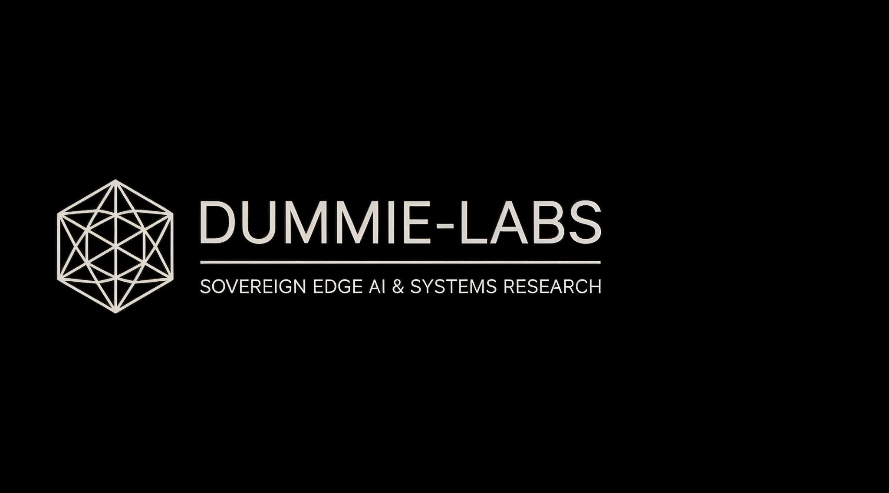
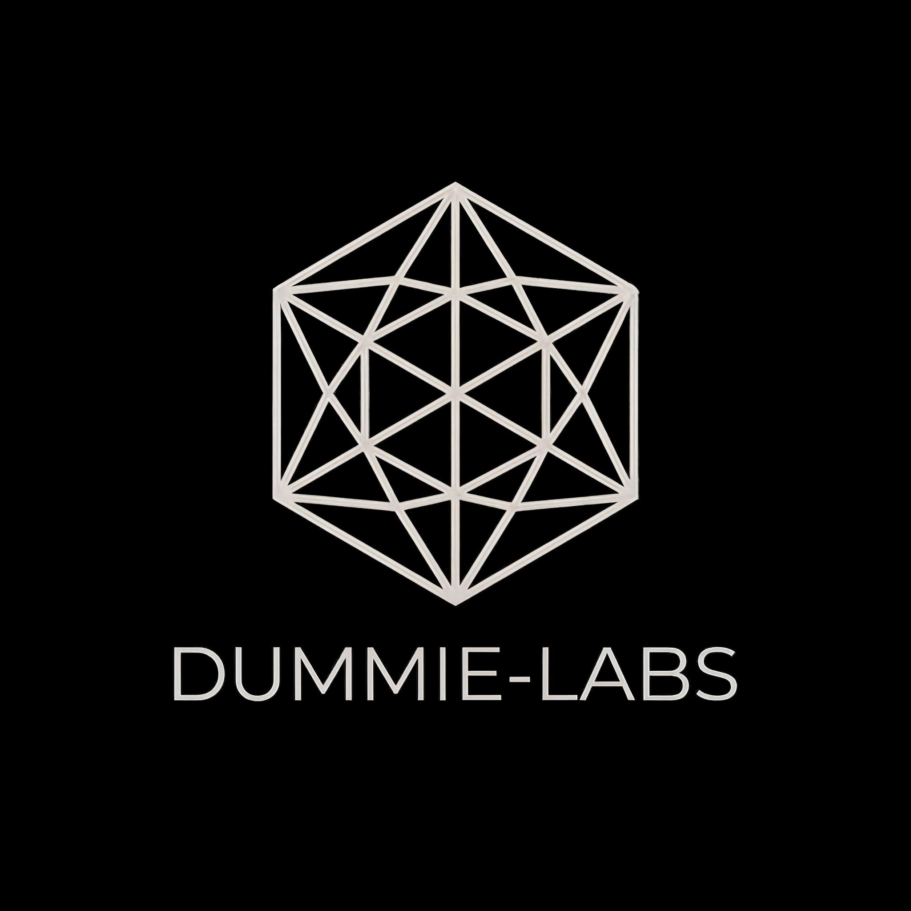

<div align="center">

  <!-- Minimalist High-Performance Header Banner -->
  

  <br/><br/>

  <!-- Minimalist Emblem Logo -->
  

  # ⚡ Dummie-Labs `01`

  ### *Sovereign Edge AI • Zero-Drag VRAM Architecture • Deep Systems Research*

  **Maximum throughput open-source AI models, ultra-low latency agent swarms, and sovereign edge intelligence engineered by student researchers, vibe coders, and low-level systems architects.**

  ---

  <!-- Minimalist Monochrome Badges -->
  <p align="center">
    <a href="https://github.com/Dummie-Labs"></a>
    <a href="https://github.com/Dummie-Labs"></a>
    <a href="https://github.com/Dummie-Labs"></a>
    <a href="https://github.com/Dummie-Labs"></a>
  </p>

</div>

---

## 🌟 Overview & Engineering Philosophy

Welcome to **Dummie-Labs**! We are an open-source AI research collective and engineering lab dedicated to building **high-IQ, zero-drag, sovereign AI systems** that run locally on consumer hardware.

Cloud-dependent models come with high latencies, recurring subscription costs, strict corporate filters, and severe privacy risks. At Dummie-Labs, we research and engineer architectures that prove **local, edge-native SLMs (1B–8B parameters)**—when augmented with intelligent distillation, non-parametric memory, and distributed device swarms—can match or outperform bulky cloud assistants while consuming under **10 GB VRAM**.

Our core principles:
1. ⚡ **Zero-Drag VRAM Efficiency**: Run & fine-tune high-performance models on consumer GPUs (e.g. RTX 3050 / RTX 5060 Ti) using sub-quadratic attention, sparse compute, sub-byte quantization, and non-parametric memory offloading.
2. 🔬 **Deep Systems & Agentic Research**: Pushing boundaries in Teacher-Student model distillation, sub-30ms multimodal perception cascades, and asynchronous sub-agent swarms.
3. 🛡️ **Bulletproof Security & Alignment**: Real-time semantic guardrails, inline privilege auditing (`@shield` MCP gate), and zero-data-leakage local execution.
4. 🕸️ **Cross-Device Hardware Mesh**: E.D.I.T.H.-inspired distributed networking connecting PCs, smartphones, tablets, and smart TVs into a unified private AI matrix.

---

## 🔬 Core Research & Development Tracks

Our lab actively conducts research across 6 primary vectors:

### 1. 🎓 Teacher-Student Model Distillation & Weight Shrinking
- **Research Problem**: Large SOTA models (Claude 3.5, GPT-4o, DeepSeek-R1) offer high reasoning but require cluster-scale infrastructure.
- **Our Approach**: We leverage frontier models as "Teachers" to synthesize high-yield reasoning trajectories and specialized datasets. We continuously distill this knowledge into 1B–8B edge SLMs (e.g., `Qwen-2.5-Coder-7B`) via LoRA / QLoRA adapters without degrading base weights or incurring catastrophic forgetting.
- **Key Metric**: Achieving 100+ tokens/sec on consumer GPUs with <5.5 GB base VRAM allocation.

### 2. 📝 Non-Parametric Memory & Zero-Drag Vault Architecture
- **Research Problem**: Fine-tuning neural weights to memorize dynamic daily facts causes VRAM bloat, slow model loading, and hallucination blurring.
- **Our Approach**: We decouple episodic memory from neural parameters. Dynamic facts, search digests, and user interactions are written to structured Markdown (`.md`) vaults stored directly on local NVMe SSDs.
- **Key Metric**: 0 GB GPU VRAM consumption for lifetime memory storage with <5ms local RAG context hydration.

### 3. 👁️ Spatial Multimodal Vision & 3D Face Fingerprinting
- **Research Problem**: Vision-LLMs are heavy (~8GB+ extra VRAM) and too slow for real-time video tracking.
- **Our Approach**: We deploy a multi-stage perceptual cascade pairing lightweight spatial detectors (**YOLOv11** Nano/Small) with **InsightFace** (ArcFace 512-dim multi-pose embedding vectors).
- **Key Metric**: 3D face recognition and spatial distance calculation in <20ms under 1.4 GB total VRAM overhead.

### 4. 🕸️ E.D.I.T.H. Distributed Cross-Device Mesh
- **Research Problem**: Siloed AI assistants isolated within a single application window or desktop OS.
- **Our Approach**: Built on **Tailscale** private encrypted WireGuard mesh networks (`100.x.x.x`), Dummie-Labs connects central GPU command rigs to remote field nodes (smartphones, tablets, work laptops, Smart TVs). Real-time WebRTC streams audio/video telemetry while Micro-MCP REST endpoints execute system actions.
- **Key Metric**: Sub-30ms WebRTC camera streaming and instant cross-device terminal execution worldwide.

### 5. 🛡️ Inline MCP-Shield & Semantic Security Firewalls
- **Research Problem**: Autonomous sub-agents with OS/API access are vulnerable to indirect prompt injection and unauthorized system commands.
- **Our Approach**: We develop `@shield` inline policy decorators that intercept generated action payloads, auditing privileges and sanitizing inputs before any terminal, device, or web API execution.
- **Key Metric**: 100% interception of malicious prompt injection attempts with zero latency impact on agent loops.

### 6. ⚡ Ephemeral Async Sub-Agent Swarms (`jcode`-Style)
- **Research Problem**: Frameworks like AutoGen/CrewAI suffer from heavy serialization overhead and persistent memory drag.
- **Our Approach**: High-speed pure `asyncio` event loops that dynamically spawn specialized sub-agents (web search, data synthesis, OS execution). Sub-agents execute tasks, sync results to `.md` memory notes, and immediately self-destruct (`destroy()`) to free RAM and VRAM.

---

## 📊 Research Matrix & Hardware Benchmarks

| Research Track | Primary Objective | Tech Stack | VRAM / Latency Impact |
| :--- | :--- | :--- | :--- |
| **Teacher-Student Distillation** | Distill SOTA reasoning into sub-8B edge models | `PyTorch`, `Unsloth`, `vLLM`, `QLoRA` | ~5.2 GB VRAM |
| **Markdown Vault Memory** | Non-parametric RAG storage on NVMe SSD | `Obsidian .md`, `Polars`, `Fast-RAG` | **0 GB VRAM** (<5ms) |
| **Spatial Vision Cascade** | 3D Face Fingerprinting & spatial distance tracking | `YOLOv11`, `InsightFace`, `MediaPipe` | ~1.4 GB VRAM (<20ms) |
| **E.D.I.T.H. Device Mesh** | Cross-device telemetry & remote MCP action bridge | `Tailscale`, `WebRTC`, `FastAPI`, `ADB` | <30ms network latency |
| **MCP-Shield Security** | Inline prompt injection defense & policy auditing | `Python`, `MCP Protocol`, `@shield` | <2ms audit overhead |
| **Ephemeral Async Swarm** | Zero-bloat sub-agent orchestration (`jcode`-style) | `Asyncio`, `WebSockets`, `Playwright` | Dynamic / Self-destruct |

---

## 🏆 Featured Repositories

<div align="center">

| Project | Description | Research Focus | Status |
| :--- | :--- | :--- | :---: |
| 🐉 [**Agent-Dummie**](https://github.com/Dummie-Labs/Agent-Dummie) | Sovereign, edge-native multimodal AI companion & device mesh system. | Edge SLM + Multimodal Mesh | 🟢 Active |
| 🛡️ [**mcp-shield**](#) | Lightweight inline safety firewall & prompt injection guard for MCP agents. | AI Safety & Alignment | 🟢 Active |
| ⚡ [**vram-aero**](#) | PyTorch memory optimization & custom CUDA kernels for zero-drag inference. | Memory Systems | 🟡 In Dev |
| 📝 [**md-brain-rag**](#) | Instant plain-text Markdown memory vault indexing for local SLMs. | Non-Parametric Memory | 🟢 Active |
| 📊 [**dummie-bench**](#) | Hardware benchmark measuring intelligence per watt & VRAM efficiency. | Systems Evaluation | 🔵 Planning |

</div>

---

## 🛠️ Core Research & Tech Stack

```
  Engine & Compute     : PyTorch • vLLM • Ollama • Unsloth • FlashAttention-2
  Vision & Perception  : YOLOv11 • InsightFace (ArcFace) • MediaPipe • OpenCV
  Memory & Systems     : Obsidian Markdown Vault • Fast-RAG • Polars • CUDA C++
  Mesh & Agent Logic   : Tailscale WireGuard • Python Asyncio • FastAPI • MCP Protocol
  Security & Telemetry : MCP-Shield • WebSockets • WebRTC • Weights & Biases
```

<p align="center">
  
  
  
  
  
  
</p>

---

## 👤 Founders & Lead Researchers

- **Kucharlapati Sri Rishikesh Varma** ([@rishikeshvarma](https://github.com/rishikeshvarma))
  - *Focus*: Computer Science & Engineering (AI/ML) | Sovereign Agent Architecture & Edge Systems Optimization.

---

## 🤝 Join the Lab (Contribute)

Whether you are writing custom CUDA kernels, researching lightweight prompt injection defenses, optimizing edge vision pipelines, or vibe-coding local AI applications, we welcome your contributions!

- 💬 **Discord**: [Join Dummie-Labs Discord](#)
- 📢 **X / Twitter**: [@DummieLabs](#)
- 🌐 **Vault Documentation**: [`Dummie.md`](https://github.com/Dummie-Labs) & [`Agent-Dummie BTS.md`](https://github.com/Dummie-Labs)

---

<div align="center">
  <sub>Engineered with ⚡ speed & ❤️ research passion by <b>Dummie-Labs</b>.</sub>
</div>
