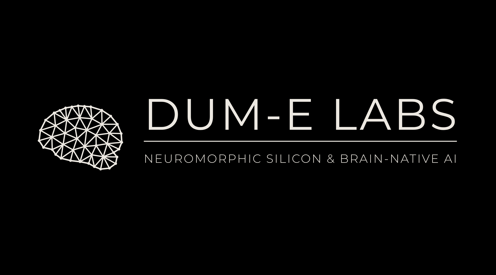
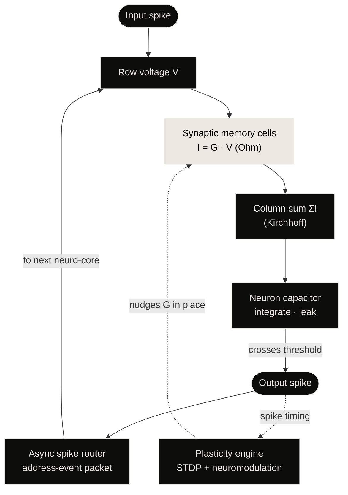

 

# Memory that thinks.

**We're building MNEMOS, a neuromorphic processor where storage _is_ the processor, and SOMA, AI models whose neurons spike, rewire and learn while they run. It's modelled on the 20-watt computer in your head.**

 

 

| External RAM | Full-load power | Weight movement | Learning |
| :---: | :---: | :---: | :---: |
| **0 GB** | **20–40 W** | **≈ 0 bytes** | **Live, on-chip** |

Design targets · pre-silicon

---

## 01 — The wall

Every computer since 1945 keeps **memory** and **processing** in separate places. To do one multiply, a GPU fetches the weight from RAM, carries it across a bus, computes, and writes the result back, billions of times per token. The fetching costs far more than the maths. This is the **von Neumann bottleneck**.

| Number | What it means | Source |
| :--- | :--- | :--- |
| **≈ 170×** | more energy to fetch a 32-bit word from DRAM (≈ 640 pJ) than to multiply it (≈ 3.7 pJ) | 45 nm, Horowitz, ISSCC 2014 |
| **~20 W** | what the human brain uses to run ~86 billion neurons and learn continuously | Raichle & Gusnard, PNAS 2002 · Azevedo et al. 2009 |
| **700 W** | one flagship datacenter GPU, before networking, RAM and cooling | NVIDIA H100 SXM, max TDP |

---

## 02 — The blueprint: the human brain

In your head, a memory isn't stored in one place and processed in another. It's the strength of the connections between neurons. Remembering, computing and learning all happen in the same synapses, triggered only by sparse electrical spikes.

| 86 billion | ~10¹⁴ | ~20 W | 0.1–10 Hz | No clock | No RAM |
| :---: | :---: | :---: | :---: | :---: | :---: |
| neurons | synapses: memory & compute | total power | typical firing: mostly silent | events, not cycles | state lives in the network |

**Each brain region maps onto our silicon:**

| Region | In the brain | In MNEMOS · SOMA |
| :--- | :--- | :--- |
| **Frontal lobe** | Holds goals and plans as sustained, recurrent firing: working memory and reasoning | Executive circuits keep the current goal "in mind" as recurrent spiking attractors: working memory made of live activity, not RAM |
| **Parietal lobe** | Binds touch, vision and body position into one model of space; steers attention | The spike router: events from different sensor cores meet, and routing tables decide which cores hear which spikes |
| **Temporal lobe · hippocampus** | Hearing and language; the hippocampus learns new episodes in one shot and replays them in sleep | Fast-plastic memory tiles store new episodes instantly; consolidation copies them into stable long-term arrays |
| **Occipital lobe** | Vision, built up layer by layer: edges → shapes → objects | Sensory encoder cores turn camera or event-sensor input straight into spikes, reporting only what changes |
| **Cerebellum** | ~69 of 86 billion neurons; predicts the outcome of every movement and corrects errors in milliseconds | Prediction cores: regular, massively parallel arrays that learn forward models and emit learning signals |

**One neuron, two substrates:**

| Biological neuron | | MNEMOS circuit |
| :--- | :---: | :--- |
| Dendrites | → | Crossbar row lines carry input voltage |
| Synapse strength | → | Memory-cell conductance **G** = the weight |
| Soma integrates | → | Capacitor sums column current, leaks over time |
| Threshold → spike | → | Comparator fires a 1-bit event and resets |
| Axon | → | Asynchronous router sends a tiny address packet |
| Plasticity | → | Programming pulses nudge **G** in place |

---

## 03 — MNEMOS-1: a processor made of memory

**MNEMOS** (from *Mnemosyne*, the Greek goddess of memory) is our neuromorphic processor architecture. There's no CPU next to a memory bank. Instead there's one fabric of neuro-cores, each of which stores synaptic weights **and** computes with them in the same place.

**How it works**

1. **One fabric, not two.** A grid of neuro-cores, each one memory and processor at once. There's no cache hierarchy and no DRAM on the board, so a weight never travels.
2. **Four layers, one job.** Synaptic memory arrays · neuron circuits · spike router mesh · plasticity engine.
3. **Weights are stored as conductance.** Every synapse is a non-volatile analog memory cell (ReRAM / PCM-class). The model isn't loaded into the chip; it's physically written into it.
4. **Physics does the maths.** Voltage on a row times conductance gives current, *I = G·V* (multiply). Currents on a column add up (accumulate). A whole matrix-vector product settles in one analog step, in place.
5. **Neurons integrate and fire.** Column current charges a membrane capacitor that leaks; at threshold it spikes, resets and rests, like a biological soma.
6. **Only spikes travel, only when needed.** There's no global clock. With 1–5 % of neurons active at any instant, most of the chip is dark most of the time, which is how **20–40 W covers full load**.
7. **It learns while it runs.** Local circuits apply spike-timing-dependent plasticity, and a global "dopamine" signal decides which changes stick.
8. **Switch it off. It remembers.** Non-volatile synapses keep the model with zero power. It's instant-on, with no weight loading and no RAM to refill.

<b>MNEMOS-1 target specification</b> (design targets · pre-silicon)

 

| Spec | Target |
| :--- | :--- |
| **Architecture** | Analog compute-in-memory, spiking neuro-cores |
| **Synaptic memory** | Non-volatile multi-level cells (ReRAM / PCM-class) |
| **External DRAM** | None. Weights and state live on-fabric |
| **Power envelope** | 20–40 W at full load · µW–mW when idle |
| **Latency** | Single analog settle per layer: no fetch, no decode |
| **Interconnect** | Asynchronous address-event 2D mesh, clockless |
| **Learning** | On-chip STDP + three-factor neuromodulated rules |
| **Persistence** | Instant-on; weights survive power-off |

| | Human brain | **MNEMOS-1** (target) | GPU + DRAM |
| :--- | :--- | :--- | :--- |
| Where memory lives | In synapses | **In synaptic cells** | Separate RAM chips |
| Where compute happens | In the same synapses | **In the same cells** | Separate cores |
| Data movement per op | None | **≈ None** | Every weight, every step |
| Timing | Event-driven, no clock | **Event-driven, clockless** | GHz global clock |
| Activity | Sparse spikes | **Sparse spikes (1–5 %)** | Dense: all units, all steps |
| Learning | Continuous, local | **Continuous, on-chip** | Offline, in a datacenter |
| After power-off | N/A (always on) | **Remembers everything** | RAM wiped, reload model |
| Power | ~20 W | **20–40 W** | 700 W per GPU |

---

## 04 — SOMA: AI that works the way neurons work

**SOMA** (**S**piking · **O**nline-learning · **M**emory-resident · **A**daptive) is our family of brain-native models, built to run natively on MNEMOS. A transformer recomputes every weight for every token and never changes after training. SOMA neurons spike only when they have something to say, and their connections strengthen, weaken, grow and disappear as they run.

- **Spiking neurons.** Leaky integrate-and-fire units with adaptive thresholds. Meaning lives in *which* neurons fire and *when*.
- **Dynamic weights.** Spike-timing-dependent plasticity updates every synapse locally, during inference: neurons that fire together wire together.
- **Structural plasticity.** New synapses sprout between co-active neurons and unused ones are pruned. The graph rewires itself.
- **Neuromodulation.** Three-factor learning: local spike timing proposes a change, a global reward or surprise signal approves it.
- **Memory without RAM.** Context is held in membrane potentials and fast synapses, and knowledge in non-volatile conductances. There's no KV cache.
- **Sleep & consolidation.** Idle-time replay moves fresh memories into stable long-term synapses, so new skills don't erase old ones.

| Transformer on a GPU | **SOMA on MNEMOS** |
| :--- | :--- |
| Every token touches every weight | **Only spiking paths do any work** |
| Weights frozen after training | **Weights adapt while it runs** |
| Context in a KV cache in RAM | **Context in neuron & synapse state** |
| Learns offline, in a datacenter | **Learns on-device, continuously** |
| Fixed, hand-designed graph | **Connections grow and prune themselves** |

---

## 05 — The road to brain-scale intelligence

Artificial superintelligence won't come from making datacenters bigger. We think it comes from systems that learn continuously, remember without forgetting, and reason on a brain's energy budget.

| Phase | Milestone | What it proves |
| :--- | :--- | :--- |
| **0 · Now** | **SOMA in simulation** | Spiking models, plasticity rules and neuromodulated learning, benchmarked on *intelligence per watt* |
| **1** | **Neuro-core on FPGA** | A digital twin of a MNEMOS core: LIF circuits, address-event router, on-chip STDP |
| **2** | **Analog test silicon** | A memristive crossbar test chip: multi-level conductance, drift, endurance, energy per synaptic event |
| **3** | **MNEMOS-1** | A multi-core neuromorphic processor in a 20–40 W envelope, running SOMA natively with no RAM |
| **4** | **Brain-scale fabrics** | Tiled MNEMOS systems scaling toward cortical neuron counts, with agents that learn for years |
| **Horizon** | **Human-like general intelligence, then beyond** | Minds that perceive, remember, reason and adapt like people, at the energy of a human brain |

<b>Phase 0 today: the DUM-E agent and our edge-AI research</b>

 

**DUM-E** is our on-device AI agent. Today it runs on consumer GPUs; it will be the first workload ported to SOMA on MNEMOS. The software research behind it:

| Track | Focus |
| :--- | :--- |
| **Teacher-student distillation** | Distilling frontier-model reasoning into 1B–8B edge models with LoRA / QLoRA |
| **Non-parametric memory** | Long-term memory in plain Markdown vaults on local SSDs: 0 GB VRAM, millisecond recall |
| **Spatial vision cascade** | Lightweight detectors + face embeddings for real-time perception on a small VRAM budget |
| **Cross-device mesh** | Private WireGuard mesh linking PCs, phones, tablets and TVs into one agent |
| **MCP-Shield** | Inline policy checks that stop prompt-injected actions before they execute |
| **Ephemeral agent swarms** | Async sub-agents that spawn, work, write to memory and self-destruct |

---

## 06 — The lab

DUM-E Labs is an independent research lab working at the boundary of **neuroscience**, **analog circuit design** and **machine learning**. If you think in spikes, synapses or sense amplifiers, we'd like to build with you.

**Founder & lead researcher:** **Kucharlapati Sri Rishikesh Varma** 
[GitHub @rishikeshvarma](https://github.com/rishikeshvarma) · [LinkedIn](https://www.linkedin.com/in/rishikeshvarma-kucharlapati/)

**We're looking for:** analog / mixed-signal circuit designers · spiking neural network researchers · FPGA & digital design engineers · computational neuroscientists · systems & compiler engineers.

---

<b>DUM-E LABS</b> · Neuromorphic silicon & brain-native AI 
<a href="https://dummie-labs.github.io/.github/">Website</a> · <a href="https://github.com/Dummie-Labs">GitHub</a> · <a href="https://www.linkedin.com/in/rishikeshvarma-kucharlapati/">LinkedIn</a> 
MNEMOS and SOMA specifications are research targets, not shipping products.

